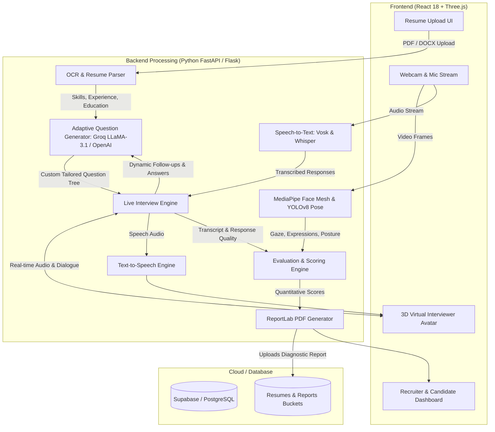

# 🎯 FYP - HireGenAI: AI-Powered Autonomous Interview & Candidate Assessment System

[](https://www.python.org/)
[](https://react.dev/)
[](https://threejs.org/)
[](https://groq.com/)
[](https://developers.google.com/mediapipe)
[](https://vitejs.dev/)
[](https://opensource.org/licenses/MIT)

> **Final Year Project (FYP):** An end-to-end, multi-modal artificial intelligence recruitment ecosystem that automates candidate screening, conducts real-time adaptive interviews with a **3D virtual avatar**, performs computer-vision-based proctoring and behavioral assessment, and automatically generates quantitative diagnostic evaluation reports.

---

## 📑 Table of Contents
- [Executive Overview](#-executive-overview)
- [System Architecture](#-system-architecture)
- [Key Features & Capabilities](#-key-features--capabilities)
- [Technical Stack](#-technical-stack)
- [Project Directory Structure](#-project-directory-structure)
- [Installation & Local Setup](#-installation--local-setup)
  - [Backend Setup](#1-backend-setup)
  - [Frontend Setup](#2-frontend-setup)
  - [Running with Launcher Script](#3-one-click-launcher-windows)
- [Production & Deployment](#-production--deployment)
- [Environment Configuration](#-environment-configuration)
- [License](#-license)

---

## 💡 Executive Overview

Traditional recruitment pipelines are bottlenecked by resume screening latency, inconsistent human interview standards, and resource constraints. **HireGenAI** bridges this gap by providing an autonomous, impartial, and highly scalable AI interviewer. 

Candidates upload their resume, engage in a live voice-and-video conversation with a responsive 3D interviewer avatar, and receive instant, unbiased, multi-dimensional performance feedback—allowing talent acquisition teams to fast-track hiring decisions with actionable data.

---

## 🏗 System Architecture



---

## 🚀 Key Features & Capabilities

### 1. Multi-Format Resume Parsing & OCR
- Automatically ingests PDF and DOCX resumes using high-precision text and OCR extraction.
- Maps technical competencies, work history, educational credentials, and domain strengths into an actionable candidate profile.

### 2. Context-Aware Adaptive LLM Interviewer
- Dynamically generates interview questions tailored to the candidate's exact background.
- Adjusts difficulty and asks intelligent follow-up questions in real-time based on the depth of the candidate's responses using **Groq-accelerated LLaMA-3.1** and **OpenAI GPT** models.

### 3. Interactive 3D Avatar Interviewer
- Integrated **Three.js / React Three Fiber** virtual interviewer avatar.
- Implements dynamic speech synthesis with lip-syncing and natural facial expressions to provide an authentic, engaging interview experience.

### 4. Multi-Modal Vision & Speech Analysis
- **Speech-to-Text (STT):** Offline, low-latency speech recognition utilizing **Vosk** models paired with Whisper for noise-resilient transcription.
- **Vision Proctoring & Eye Gaze Tracking:** Powered by **Google MediaPipe**, tracking facial landmarks, eye contact ratio, and head orientation.
- **Pose Detection:** Real-time **YOLOv8-pose** monitoring candidate presence, body language, and interview integrity.

### 5. Automated Diagnostic PDF Report Generation
- Generates a comprehensive evaluation report upon interview completion.
- Quantitatively scores candidates across:
  - **Technical Competency & Knowledge Depth**
  - **Communication Clarity & Articulation**
  - **Problem-Solving Approach**
  - **Behavioral & Non-Verbal Confidence**
- Provides hiring recommendations (Strong Hire, Hire, Hold, Re-evaluate) alongside verbatim transcripts.

---

## 🛠 Technical Stack

| Layer | Technologies |
| :--- | :--- |
| **Frontend** | React 18, Vite, Three.js, `@react-three/fiber`, `@react-three/drei`, TailwindCSS |
| **Backend** | Python 3.10+, FastAPI, Flask, AsyncIO, Uvicorn |
| **AI / LLM** | Groq LLaMA-3.1-70B, OpenAI GPT-4o, LangChain |
| **Speech & Audio** | Vosk Speech Recognition (offline), pyttsx3 / gTTS, SoundFile |
| **Computer Vision** | Google MediaPipe (Face Mesh, Eye Gaze), Ultralytics YOLOv8 (Pose), OpenCV |
| **Document & PDF** | PyMuPDF (fitz), ReportLab, pdfplumber |
| **Database & Cloud** | Supabase (PostgreSQL & Object Storage), Firebase Hosting, Azure Static Web Apps |
| **DevOps & Proxy** | Docker, Nginx with SSL, Bash / Batch automation |

---

## 📂 Project Directory Structure

```text
HIREGEN-AI/
├── backend_python/                 # Python AI & Backend Services
│   ├── Backend/                    # FastAPI Core & Live Services
│   │   ├── main.py                 # REST & WebSocket Endpoints
│   │   └── services/               # Live Interview Engine & State
│   ├── email_system/               # Automated Candidate Email Service
│   ├── face_for_interviewer/       # MediaPipe Face & Gaze Tracking
│   ├── main_questions_interviewer/ # Question Generation Engine
│   ├── report_genrater/            # ReportLab Scoring & PDF Generator
│   ├── resume/                     # Resume OCR & Extraction Pipelines
│   ├── text_to_voice/              # TTS Audio Synthesis
│   ├── voice_for_interviewer/      # Audio Ingestion & Transcription
│   ├── Dockerfile                  # Containerization specification
│   ├── requirements.txt            # Python Dependencies
│   └── .env.example                # Backend Environment Template
├── frontend-react/                 # React 18 Single Page Application
│   ├── src/
│   │   ├── components/             # 3D Avatar, Audio Visualizer, UI Components
│   │   ├── pages/                  # Landing, Upload, Live Interview, Dashboard
│   │   └── config.js               # API & Supabase Endpoints
│   ├── public/                     # 3D Models (.glb), Textures, Audio Assets
│   ├── package.json                # Frontend Dependencies
│   └── .env.example                # Frontend Environment Template
├── nginx-ssl-config.conf           # Production Nginx Reverse Proxy with SSL
├── run_hiregen.bat                 # One-click Windows local development launcher
└── README.md                       # Master System Documentation
```

---

## ⚡ Installation & Local Setup

### Prerequisites
- **Python 3.10 or 3.11** installed.
- **Node.js (v18+)** and `npm` installed.
- Working webcam and microphone for live testing.

---

### 1. Backend Setup

```bash
# Navigate to backend directory
cd backend_python

# Create and activate a virtual environment
python -m venv .venv
# Windows:
.venv\Scripts\activate
# Linux/macOS:
source .venv/bin/activate

# Install dependencies
pip install -r requirements.txt

# Configure environment variables
cp .env.example .env
# Open .env and add your OPENAI_API_KEY or GROQ_API_KEY

# Start backend server
python Backend/main.py
```
*Backend runs on `http://localhost:8000`.*

---

### 2. Frontend Setup

```bash
# Navigate to frontend directory
cd frontend-react

# Install dependencies
npm install --legacy-peer-deps

# Configure environment variables
cp .env.example .env
# Fill in your Supabase credentials if using cloud storage

# Start frontend development server
npm run dev
```
*Frontend will launch at `http://localhost:5173`.*

---

### 3. One-Click Launcher (Windows)
Double-click `run_hiregen.bat` in the root folder to automatically spin up both the Python backend and React frontend dev server simultaneously!

---

## 🌐 Production & Deployment

- **Reverse Proxy:** Includes complete Nginx configurations (`nginx-ssl-config.conf`, `nginx-full-config.conf`) for SSL termination, WebSocket proxying, and caching.
- **Docker:** `backend_python/Dockerfile` is pre-configured for containerized cloud deployment on AWS ECS, GCP Cloud Run, or Azure App Service.
- **CI/CD:** Configured with GitHub Actions workflows (`.github/workflows/`) for automated Azure Static Web Apps deployment.

---

## ⚙️ Environment Configuration

### Backend (`backend_python/.env`)
```ini
HR_NAME=HireGen AI Recruiting
HR_EMAIL=recruitment@example.com
OPENAI_API_KEY=your_openai_key
GROQ_API_KEY=your_groq_key
GROQ_MODEL=llama-3.1-70b-versatile
```

### Frontend (`frontend-react/.env`)
```ini
VITE_SUPABASE_URL=https://your-project.supabase.co
VITE_SUPABASE_ANON_KEY=your_supabase_anon_key
HOST=0.0.0.0
PORT=5173
```

---

## 📜 License
This project is developed as an academic **Final Year Project (FYP)** and is released under the [MIT License](LICENSE).
